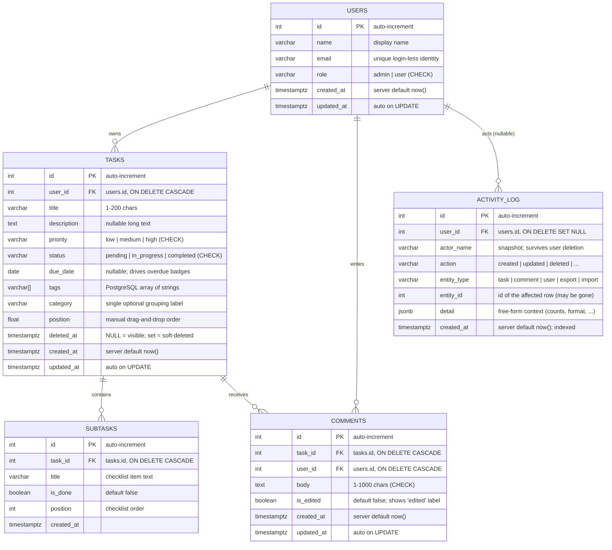

# ============================================================================
# FILE:       docs/DATABASE_SCHEMA.md
# PURPOSE:    Document every table, column, constraint, index and relationship
#             in the TaskFlow PostgreSQL database, so a learner can understand
#             the schema without reading SQL in the migration file.
# HOW IT WORKS: Section 1 is a Mermaid ER (entity-relationship) diagram.
#             Section 2 explains each table column-by-column, including why
#             each type, nullability, default and cascade rule was chosen.
#             Section 3 summarizes relationships, section 4 covers indexes and
#             the soft-delete design.
# USED BY / DEPENDS ON: Matches `backend/app/models/*.py` (Phase 2) and the
#             first Alembic migration exactly. Render Mermaid in any
#             Markdown viewer that supports it (VS Code extension, GitHub).
# KEY CONCEPTS: primary key, foreign key, ON DELETE CASCADE, CHECK constraint,
#             array column, index, soft delete, audit log, timezone-aware
#             timestamps.
# ============================================================================

# TaskFlow Database Schema

---

## 1. ER Diagram (Mermaid)



---

## 2. Table-by-Table Reference

### 2.1 `users`

Real-world meaning: a person who can own tasks. There is **no password** —
identity comes from the `X-User-Id` header, and `role` decides permissions.

| Column | Type | Null? | Default | Meaning & reasoning |
|---|---|---|---|---|
| `id` | `INTEGER` | NO | `GENERATED ALWAYS AS IDENTITY` | Primary key. Integer keeps URLs short (`/tasks/42`). Identity is the modern SQL standard for auto-increment (preferred over `SERIAL`). |
| `name` | `VARCHAR(80)` | NO | — | Display name shown in headers and comment authorship. Bounded length prevents abuse. |
| `email` | `VARCHAR(255)` | NO | — | Unique per user; used only as a human-readable identifier in the admin table (there is no login). `UNIQUE` constraint creates an implicit index and rejects duplicates with error **409**. |
| `role` | `VARCHAR(10)` | NO | `'user'` | `admin` or `user`. `CHECK (role IN ('admin','user'))` guarantees only valid values ever enter the table — defense in depth even if the API had a bug. |
| `created_at` | `TIMESTAMPTZ` | NO | `now()` | When the account was created. `TIMESTAMPTZ` stores an absolute instant, so `now()` is UTC — the API converts to ISO-8601 for the frontend. |
| `updated_at` | `TIMESTAMPTZ` | NO | `now()` | Last change; SQLAlchemy refreshes it automatically on `UPDATE` (`onupdate`). |

Every column also carries a PostgreSQL `COMMENT` (set via SQLAlchemy's
`comment=` argument), so `\d+ users` inside psql shows the same explanations.

---

### 2.2 `tasks`

Real-world meaning: one todo item belonging to exactly one user. This is the
central table of the app.

| Column | Type | Null? | Default | Meaning & reasoning |
|---|---|---|---|---|
| `id` | `INTEGER` | NO | identity | Primary key referenced by `subtasks`, `comments` and the activity log. |
| `user_id` | `INTEGER` | NO | — | Foreign key → `users.id`. **`ON DELETE CASCADE`**: deleting a user removes their tasks, because a task without an owner can never be displayed (the admin UI shows a confirmation warning about exactly this). Indexed — also the primary lookup for the user panel. |
| `title` | `VARCHAR(200)` | NO | — | Short summary shown on the card. Length 1–200 enforced by Pydantic (`TaskCreate`) *and* by a `CHECK` in the database. |
| `description` | `TEXT` | YES | `NULL` | Optional long-form details; nullable because most tasks don't need one. |
| `priority` | `VARCHAR(10)` | NO | `'low'` | `low`/`medium`/`high` with a `CHECK`. Stored as text (not a Postgres enum type) so adding a new level later never requires an enum ALTER type migration — a beginner-friendly trade-off. |
| `status` | `VARCHAR(15)` | NO | `'pending'` | `pending`/`in_progress`/`completed`, `CHECK`-constrained. The toggle endpoint flips `pending ⇄ completed`. Indexed because the filter is used constantly. |
| `due_date` | `DATE` | YES | `NULL` | Plain calendar date (no time-of-day needed). Nullable = "no deadline". Indexed because overdue/due-today filters compare it on every list request. |
| `tags` | `VARCHAR(60)[]` | NO | `'{}'` | A PostgreSQL **array of strings** — real multi-valued data instead of a delimited string. Filtering with `tag=work` becomes `work = ANY(tags)`, which is exact and index-friendly; export joins with `;` for CSV. |
| `category` | `VARCHAR(60)` | YES | `NULL` | Single optional grouping label (e.g. "Work"), separate from free-form tags. |
| `position` | `DOUBLE PRECISION` | NO | `0` | Manual drag-and-drop order. Stored as a *fractional* number so inserting between two cards (`1.0`, `2.0` → new `1.5`) needs no mass renumbering. The `reorder` endpoint normalizes back to integers after each drop. |
| `deleted_at` | `TIMESTAMPTZ` | YES | `NULL` | **Soft delete** marker: `NULL` = visible, any timestamp = deleted. Enables the 5-second "Undo" toast and keeps comments/audit history intact. |
| `created_at` | `TIMESTAMPTZ` | NO | `now()` | Creation instant; default sort key (`sort=created`). |
| `updated_at` | `TIMESTAMPTZ` | NO | `now()` | Auto-refreshed on every `UPDATE`. |

---

### 2.3 `subtasks`

Real-world meaning: one checklist item inside a task ("buy milk" inside
"plan dinner"). Deleting the parent task removes its checklist automatically.

| Column | Type | Null? | Default | Meaning & reasoning |
|---|---|---|---|---|
| `id` | `INTEGER` | NO | identity | Primary key. |
| `task_id` | `INTEGER` | NO | — | Foreign key → `tasks.id`, **`ON DELETE CASCADE`** so orphan checklist rows can never exist. Indexed — every task load fetches its subtasks with one indexed lookup. |
| `title` | `VARCHAR(200)` | NO | — | The checklist item text; same 1–200 rule as task titles. |
| `is_done` | `BOOLEAN` | NO | `false` | Checked/unchecked state; defaults to unchecked so a subtask can be created with one field. Drives the task progress bar (`done / total`). |
| `position` | `INTEGER` | NO | `0` | Order inside the checklist. Integer is enough here because subtasks are rarely reordered mid-list (no fractional gaps needed). |
| `created_at` | `TIMESTAMPTZ` | NO | `now()` | When the item was added. |

---

### 2.4 `comments`

Real-world meaning: a discussion entry attached to a task, authored by a user.

| Column | Type | Null? | Default | Meaning & reasoning |
|---|---|---|---|---|
| `id` | `INTEGER` | NO | identity | Primary key. |
| `task_id` | `INTEGER` | NO | — | Foreign key → `tasks.id`, **`ON DELETE CASCADE`**: deleting a task deletes its thread. Indexed — the thread query orders by `created_at` for one task. |
| `user_id` | `INTEGER` | NO | — | Foreign key → `users.id`, **`ON DELETE CASCADE`**: deleting a user removes their comments (admin confirms this). *Alternative rejected:* `SET NULL` would make comments anonymous and un-moderable. |
| `body` | `TEXT` | NO | — | The comment text, `CHECK`-enforced to 1–1000 characters **after trimming** (`btrim(body) <> ''` rejects whitespace-only comments) — mirrors the Pydantic rule so the DB is the last line of defense. |
| `is_edited` | `BOOLEAN` | NO | `false` | Set to `true` on `PATCH .../comments/{id}` so the UI can show an *(edited)* label; a plain timestamp comparison would be fragile (any update touches `updated_at`). |
| `created_at` | `TIMESTAMPTZ` | NO | `now()` | Shown as relative time ("5 min ago") with the full timestamp on hover; also the thread's ordering key (newest last). |
| `updated_at` | `TIMESTAMPTZ` | NO | `now()` | Refreshed on edit. |

---

### 2.5 `activity_log`

Real-world meaning: an append-only audit trail — "who did what, to which
entity, and when" — shown on the admin Activity page.

| Column | Type | Null? | Default | Meaning & reasoning |
|---|---|---|---|---|
| `id` | `INTEGER` | NO | identity | Primary key. |
| `user_id` | `INTEGER` | YES | `NULL` | Foreign key → `users.id`, **`ON DELETE SET NULL`**: when a user is deleted the historical log must survive (an audit trail that deletes its own entries is useless). |
| `actor_name` | `VARCHAR(80)` | NO | — | Snapshot of the actor's name at action time, so the entry still shows *who* after `user_id` became `NULL`. |
| `action` | `VARCHAR(20)` | NO | — | `created`, `updated`, `deleted`, `restored`, `toggled`, `reordered`, `imported`, `exported`, `login_as`. |
| `entity_type` | `VARCHAR(20)` | NO | — | `task`, `comment`, `user`, `export`, `import` — lets the UI filter the log. |
| `entity_id` | `INTEGER` | YES | `NULL` | Id of the affected row. Nullable because export/import act on many rows at once (the count lives in `detail`). May reference a row that was later deleted — that is normal for logs. |
| `detail` | `JSONB` | YES | `'{}'` | Flexible context: `{"format":"csv","rows":120}`, `{"title":"..."}`, `{"on_duplicate":"skip"}`. JSONB (binary JSON) supports indexing and fast containment queries if we need them later. |
| `created_at` | `TIMESTAMPTZ` | NO | `now()` | Indexed — the activity page always sorts newest first. |

---

## 3. Relationships & Cascade Rules

| Relationship | Type | On delete of parent |
|---|---|---|
| `users` → `tasks` | one-to-many (`tasks.user_id`) | CASCADE — user's tasks vanish (admin confirm dialog warns) |
| `tasks` → `subtasks` | one-to-many (`subtasks.task_id`) | CASCADE — checklist vanishes with the task |
| `tasks` → `comments` | one-to-many (`comments.task_id`) | CASCADE — thread vanishes with the task |
| `users` → `comments` | one-to-many (`comments.user_id`) | CASCADE — user's comments vanish |
| `users` → `activity_log` | one-to-many, nullable (`activity_log.user_id`) | SET NULL — log survives, keeps `actor_name` |

---

## 4. Indexes & Soft Delete

```sql
-- Why each index exists (created in the first Alembic migration):
CREATE INDEX ix_tasks_user_id    ON tasks (user_id);         -- "my tasks" panel
CREATE INDEX ix_tasks_status     ON tasks (status);          -- status filter
CREATE INDEX ix_tasks_due_date   ON tasks (due_date);        -- overdue / due-today filters
CREATE INDEX ix_subtasks_task_id ON subtasks (task_id);      -- checklist per task
CREATE INDEX ix_comments_task_id ON comments (task_id);      -- thread per task
CREATE INDEX ix_activity_created ON activity_log (created_at DESC); -- newest-first log
-- users.email already has an implicit index from its UNIQUE constraint.
```

**Soft delete design**
- `DELETE /tasks/{id}` sets `tasks.deleted_at = now()` and returns **204** — the
  row stays, so the frontend can offer **Undo** for 5 seconds (`PATCH` clearing
  `deleted_at`).
- All list queries add `WHERE deleted_at IS NULL`, so soft-deleted tasks are
  invisible to normal reads.
- If the user never undoes it, the row remains as a cheap archive (comments and
  activity history still make sense). A future scheduled job could hard-delete
  rows older than N days.
- **Why not an `is_deleted` boolean?** A timestamp also tells you *when* it was
  deleted, which the admin activity page can display for free.

**NOTE:** `created_at` / `updated_at` are NOT indexed by default — sorting
already-filtered, small pages by them costs little, and every extra index slows
every `INSERT`/`UPDATE` slightly.


